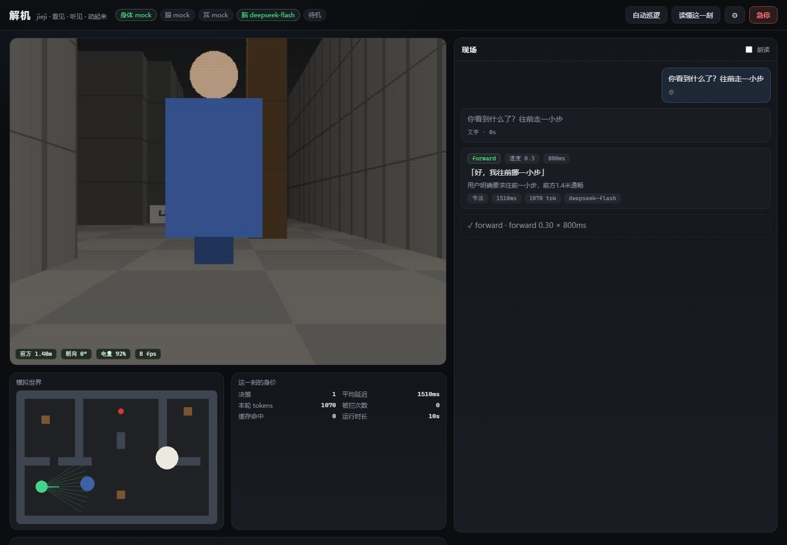

<div align="center">

# 解机 · jieji

**一个视频摄像头 + 一个麦克风 + 一个大模型 + 一台玩具机器人 = 一台会自己看路、听话、会停的机器人。**

不用改机器人固件，不用逆向遥控器协议，不用买开发板就能先跑起来。

`解音` 听 · `解画` 看 · **`解机` 动**

</div>



---

## 这是什么

你说一句"往前走一点，别撞到人"，它就：

1. 用摄像头**看一眼**（VLM 描述画面：前面 1.4 米有个蓝色人形挡路）；
2. 用耳朵**听一句**（VAD 切句 + ASR 转文字）；
3. 让大模型**想一秒**，输出一个严格受限的 JSON 决策；
4. 过一遍**安全层**（限速、限时、急停、防撞反射）；
5. 让**身体**动一小步（模拟器 / 红外遥控 / 舵机压键 / 串口电机）。

然后每隔 1.8 秒重复一次。**全部代码 3000 行左右，一个 `python serve.py` 就能跑。**

它刻意做得很窄：不接微信、不聊天、不做 Agent 编排。它只回答一个问题——
**"让一个大模型真的驱动一台物理机器人，最少需要什么，以及哪里会出事？"**

---

## 30 秒上手

```bash
git clone https://github.com/lingyuemax/jieji.git
cd jieji
pip install -r requirements.txt

cp .env.example .env          # 填一个 LLM_API_KEY（DeepSeek / OpenAI / Ollama 都行）
python serve.py               # → http://127.0.0.1:8790
```

打开页面，说一句 **"往前走一点"**。

**你现在看到的是模拟机器人**：第一人称画面是实时渲染的（不是视频），
里面的墙、走廊、站在你正前方的路人都真的会挡路。没有硬件也能把整条链路跑穿。

想换成真机器人 → 看 [`docs/hardware.md`](docs/hardware.md)，最省事的一条路是
**ESP32 学红外码，然后替你按遥控器**，半小时，30 块钱，不拆机。

---

## 它长什么样

| 页面 | 作用 |
| --- | --- |
| 左上大画面 | 实时 MJPEG。注意：**这是模型看到的东西**，不是给你看的漂亮画面 |
| 右上俯视图 | 模拟器的上帝视角，红点会动，能看出它到底走没走 |
| 右侧「现场」 | 每一句听到的话、每一个决策、每一次执行结果，带模型理由和耗时 |
| 底部方向盘 | 手动遥控，**同样过安全层**（急停时按了也不动） |
| 右上 ⚙ | 大脑 / 眼睛耳朵 / 身体 / 安全 / 教它按键 / 数据，六个页签 |
| 红色按钮 | 急停，锁存，必须手动解除 |

键盘：`WASD` 手动走，`空格` 急停。麦克风按钮用的是浏览器自带的语音识别
（Chrome / Edge 可用，不上传音频到第三方服务 —— 用的是系统识别）。

### 关于声音：默认是哑的

这个项目**不会自己出声**，这一点是刻意设计的：

- **不碰你的音箱。** 「朗读」默认关闭，只有你自己勾上才会用系统 TTS 读模型说的那句话；
  系统提示、错误、日志一律不读。半夜突然开口说话，比什么 bug 都吓人。
- **不偷开麦克风。** `AUDIO_SOURCE=mock` 是默认值；要接真麦克风得自己改配置，
  网页上的 🎙 也必须你主动点才会请求权限。
- **不写系统通知、不弹窗、不自动播放。**

```ini
SPEAK_REPLY=0      # 默认；改成 1 才会让服务端标记"该朗读"
```

---

## 一条决策回路的真实耗时

实测（DeepSeek `deepseek-flash`，关闭思考链，512px 图，JSON 模式，家宽，6 条指令）：

| 环节 | 耗时 |
| --- | --- |
| `POST /api/chat` 返回（只是入队） | **1 ~ 54 ms** |
| 组提示词（画面 + 状态 + 最近对话） | ~3ms |
| 模型往返（含一张图） | **774 ~ 1137 ms，中位 880 ms** |
| JSON 解析 + 安全层 | < 1ms |
| 驱动下发 | < 5ms |
| **总计：说完话到开始动** | **≈ 0.9 s** |
| 单次决策 token | **约 1100**（其中约 750 是那张图） |

> 这些数字是 `python scripts/bench.py` 跑出来的，不是拍脑袋写的 —— 你自己跑一遍就对得上。
> 换成本机 Ollama 跑 `qwen2.5vl:7b`，延迟会到 3~8 秒（取决于显卡），但不要钱、不联网。

**为什么不做成"越快越好"？** 1.8 秒一次的闭环已经是"人说话 → 机器人反应"的
自然节奏。再快只会让 token 翻倍、动作碎成渣。

---

## 它是怎么组织的

```
capture (线程) ──► loop (asyncio) ──► brain (HTTP) ──► safety ──► driver
   摄像头             250ms 一跳         VLM           否决权      真机
   麦克风                              +ASR
                          │
                          └──► 事件总线 (SSE) ──► 网页
                          └──► data/episodes/ (录像，给以后训练用)
```

更细的时序、故障表、取舍理由：[`docs/architecture.md`](docs/architecture.md)

三条硬规矩：

1. **`execute()` 不许阻塞。** 驱动发完就返回，自己计时自己停 —— 否则急停都执行不了。
2. **安全层有最终否决权。** 模型说 `speed=1.0`，出去的是 `0.6`；模型说"冲过去"，
   正前方 0.2 米时反射层直接改写成 `stop`。
3. **固件里还有一层。** 上位机挂掉、Wi-Fi 掉线，板子 1~2 秒收不到命令就自己停。

---

## 配置

所有东西都能在网页 ⚙ 里改，改完立即生效并写回 `data/settings.json`。
也可以直接用 `.env`（优先级：`.env` < `data/settings.json` < 网页）。

| 想干什么 | 改什么 |
| --- | --- |
| 换模型 | `LLM_BASE_URL` / `LLM_MODEL` / `LLM_API_KEY`，任意 OpenAI 兼容端点 |
| 接 USB 摄像头 | `CAMERA_SOURCE=opencv`，`CAMERA_INDEX=0` |
| 接麦克风 | `AUDIO_SOURCE=mic`，`ASR_PROVIDER=local`（faster-whisper） |
| 让它更谨慎 | `MAX_SPEED=0.3`，`REFLEX_STOP_M=0.4` |
| 接真机器人 · 红外 | `DRIVER=ir`，`DRIVER_BRIDGE_URL=ws://192.168.1.42:81` |
| 接真机器人 · 串口 | `DRIVER=serial`，`DRIVER_SERIAL_PORT=COM3` |
| 省 token | `LLM_VISION=0`（不看图，只听话和状态） |

完整清单：[`.env.example`](.env.example)

---

## 接真机器人：五条路

| 方案 | 拆机 | 花钱 | 时间 | 说明 |
| --- | --- | --- | --- | --- |
| `mock` | 不用 | 0 | 0 | 内置模拟器，先把闭环跑通 |
| **`ir`** | **不用** | **~30 元** | **30 分钟** | **ESP32 学红外码，替你按遥控器 —— 推荐** |
| `button` | 不用 | ~50 元 | 1~2 小时 | 舵机压真按键，任何遥控器都能用，慢 |
| `gpio` | 要拆遥控器 | ~10 元 | 半天 | 直连按键矩阵，风险高 |
| `serial` | 要拆机器人 | ~40 元 | 半天 | 串口直驱电机，延迟最低、能读编码器 |

接线图、BOM、注意事项：[`docs/hardware.md`](docs/hardware.md)
固件和烧录：[`firmware/`](firmware/)

> **别去逆向 2.4G 私有协议。** 一个遥控器一套协议，换个型号全部重来。
> 红外能覆盖 90% 的玩具机器人，剩下的用舵机压键，都比逆向快。

---

## 接口

| 想看什么 | 从哪看 |
| --- | --- |
| 全部 HTTP 接口 | [`docs/protocol.md`](docs/protocol.md) |
| SSE 事件格式 | 同上，第二节 |
| 遥控器桥的 WebSocket 协议 | 同上，第三节 |
| 串口协议（115200 JSON 行） | 同上，第四节 |

脚本里也能直接驱动它：

```bash
curl -X POST localhost:8790/api/chat -H 'Content-Type: application/json' \
     -d '{"text":"往左转看看"}'

curl -X POST localhost:8790/api/estop -d '{"reason":"测试"}'
curl localhost:8790/api/understand -d '{"text":"你看到什么了"}'
```

---

## 测试

```bash
python -m pytest tests -q          # 72 passed in 7s
node scripts/ui-test.mjs           # 用无头 Chrome 真的开一遍页面并截图
```

测试全部**不需要网络、不需要硬件、不需要 API Key**：假模型 + 模拟摄像头 + 模拟身体。

| 覆盖 | 关键用例 |
| --- | --- |
| 动作收敛 | 中文别名、拖尾逗号、代码块、非法枚举、速度夹紧 |
| 安全层 | 急停锁存、频率限制、限速限时、能力检查、看门狗（静止时不乱叫） |
| 模拟器 | 撞墙不穿墙、转向、测距能看见人、渲染出的是合法 JPEG |
| 耳朵 | VAD 切句、纯静音不切、唤醒词、三种识别器 |
| 身体 | 红外重复帧、没绑定的键要报错、`execute()` 不许阻塞主循环 |
| 闭环 | 说"走"真的走了、急停时真的不动、贴脸时反射层把 forward 改写成 stop |

---

## 目录

```
app/            机器人本体（Python）
  capture.py      摄像头 / 麦克风线程
  sim.py          光线投射模拟器（会挡路的那种）
  brain.py        提示词 + 决策
  safety.py       唯一有否决权的地方
  loop.py         主循环 / 事件总线 / 数据录制
  drivers/        mock · ir · button · serial · none
  server.py       FastAPI：HTTP + SSE + MJPEG
web/            驾驶舱（原生 JS，无构建步骤）
firmware/       ESP32 遥控器桥 + Arduino 电机桥
docs/           架构 / 硬件 / 协议 / 截图
tests/          71 个 pytest + 一个无头浏览器验收
```

---

## 说实话的部分

这个项目**能跑，但只是个开始**。以下是它现在还不行的地方：

- **红外方案没有测距。** 防撞反射层没数据可用，唯一的防线是 VLM 自己看出"前面有东西"
  + 限速。所以红外方案请把 `max_speed` 压到 0.3 以下。
- **1.2 秒的延迟做不了快速反应。** 接飞盘、避让跑过来的猫，都别指望。
- **模拟器不是物理引擎。** 它算光线、算碰撞、算里程，但没有惯性、没有打滑。
- **只支持一台机器人、一个进程。** 没有多机调度，没有持久化任务队列。
- **安全层拦得住"想撞墙"，拦不住"看不懂"。** 模型如果把玻璃门当成通道，代码层无能为力。

**下一步想做的**（按优先级）：接真实测距传感器 → 视觉里程计（现在纯靠里程计会漂）→
把 `data/episodes/` 攒到几千条做行为克隆 → 用本地小模型替换云端调用，做真机上的 200ms 闭环。

---

## 系列

| | 干什么 | 仓库 |
| --- | --- | --- |
| 解音 | 听：把一段音频拆成 9 个结构化字段 | `jieyin` |
| 解画 | 看：把一张图片拆成 9 个结构化字段 | `jiehua` |
| **解机** | **动：把"看 + 听"变成动作，驱动一台真机器人** | 本仓库 |

三个项目共用同一套"结构化理解"的思路：**别让模型直接输出自由文本，
让它填字段。** 字段是契约，契约才能被代码消费。

---

## 许可

MIT © 2026 林荣华

大模型、摄像头、机器人都是别人的。把这三样缝成一个闭环的胶水，是这个仓库的全部意义。
